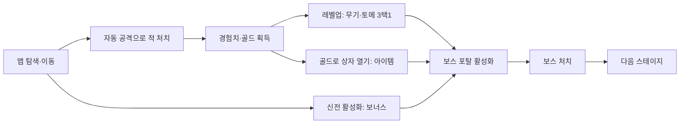

# RumbleBall

탑뷰 뱀서라이크(Survivors-like) 액션 로그라이트입니다.
**Megabonk**(Vedinad, 2025)의 맵 탐색형 구조를 탑뷰로 옮기는 것을 목표로 합니다. 상자, 신전, 보스 포탈이 그 구조의 핵심입니다.
공격은 자동으로 나갑니다. 플레이어는 이동과 대시로 맵을 누비며 빌드를 완성하고, 제한 시간 안에 보스를 쓰러뜨려야 합니다.

| 항목 | 내용 |
|------|------|
| 장르 | 탑뷰 서바이버즈라이크 / 로그라이트 |
| 레퍼런스 | Megabonk(시스템만 참고하고, 시점은 탑뷰) |
| 플랫폼 | Windows (Win64) |
| 엔진 | Unreal Engine 5.8 (C++ + Blueprint) |
| 1판 길이 | 약 15분(스테이지 2개, 스테이지당 최대 8분) |
| 입력 | 키보드·마우스, 게임패드 |

## 핵심 루프



## 스테이지 구조 (초안)

- 스테이지마다 넓은 맵이 주어지고, 상자·신전·항아리(골드)·보스 포탈이 무작위로 배치됩니다.
- 제한 시간은 **8분**입니다. 시간 안에 보스 포탈을 찾아 보스를 소환하고 처치하면 다음 스테이지로 넘어갑니다.
- 시간이 다 되면 **최종 스웜**이 시작됩니다. 적이 끝없이 강해지며 몰려와, 오래 버틸수록 사실상 패배가 확실해집니다.
- 2스테이지 보스를 처치하면 클리어, 사망하면 실패입니다. 어느 쪽이든 결과 화면에서 실버를 정산합니다.

## 성장 시스템 (초안)

| 시스템 | 얻는 방법 | 내용 |
|--------|----------|------|
| 무기 | 레벨업 선택 | 자동 공격 수단입니다. 슬롯 3칸이며, 영구 해금으로 최대 5칸까지 늘어납니다. 레벨이 오르면 데미지, 투사체 수, 범위가 강화됩니다. |
| 토메 | 레벨업 선택 | 스탯을 올리는 서적입니다(공격력, 쿨다운, 이동 속도, 경험치, 행운 등). 슬롯 3칸이며, 영구 해금으로 최대 4칸까지 늘어납니다. |
| 아이템 | 상자 | 슬롯 제한이 없는 패시브 효과입니다. 일반, 희귀, 에픽, 전설 등급이 있고 중첩됩니다. |
| 신전 보상 | 신전 | 즉시 효과를 주거나 스탯 중 하나를 고르게 합니다. |

- 레벨업하면 게임이 일시정지되고, 무기나 토메 후보 3개 중 1개를 고릅니다.
- 상자는 골드로 열고, 열 때마다 가격이 오릅니다. 보스와 엘리트가 떨어뜨리는 상자는 무료입니다.
- 행운 스탯이 높을수록 아이템 등급과 레벨업 후보의 질이 좋아집니다.

### 신전

| 신전 | 효과 |
|------|------|
| 충전 신전 | 범위 안에 일정 시간 머무르면 스탯 보상 3개 중 1개를 고릅니다. 범위를 벗어나면 충전이 초기화됩니다. |
| 도전 신전 | 엘리트 적을 소환하고, 처치하면 무료 상자를 줍니다. |
| 자석 신전 | 맵에 있는 경험치 보석을 전부 끌어옵니다. |
| 저주 신전 | 남은 스테이지의 난이도와 보상이 함께 오릅니다. |

## 메타 진행

- 판이 끝나면 얻은 실버로 상점에서 캐릭터, 무기, 토메, 추가 슬롯을 해금합니다.
- 퀘스트(업적)를 달성하면 새 아이템이 등장 후보에 추가됩니다.
- 캐릭터마다 시작 무기와 고유 패시브가 다릅니다.

모든 수치(쿨다운, 데미지, 경험치 곡선, 상자 가격, 웨이브)는 데이터 테이블로 관리하며, 플레이테스트로 조정합니다.

## 조작

| 동작 | 키보드 · 마우스 | 게임패드 |
|------|----------------|----------|
| 이동 | WASD | 왼쪽 스틱 |
| 조준 | 마우스 커서 | 오른쪽 스틱 |
| 대시 | Space | A |
| 상호작용(상자·신전·포탈) | E | X |
| 강화 선택 | 마우스 클릭 / 1·2·3 | 십자키 + A |
| 일시정지 | Esc | Start |

- **이동**은 화면 기준입니다. W를 누르면 화면 위쪽으로 갑니다.
- **조준**: 캐릭터는 항상 조준 방향을 바라봅니다. 대부분의 무기는 자동으로 적을 찾지만, 방향성 무기(샷건류 등)는 조준 방향으로 발사됩니다. 마우스를 움직이면 마우스 조준, 오른쪽 스틱을 기울이면 스틱 조준으로 자동 전환됩니다.
- **대시**: 이동 중이면 이동 방향으로, 멈춰 있으면 조준 방향으로 짧게 돌진합니다. 재사용 대기 시간이 있습니다.

## 개발 환경

- Unreal Engine 5.8 (`C:\Program Files\Epic Games\UE_5.8`)
- Visual Studio(`.vsconfig` 참고) 또는 JetBrains Rider
- Git LFS(`.uasset`과 `.umap`은 LFS로 관리합니다)

```bash
git lfs install
```

```bash
git clone https://github.com/dlgustn1245/RumbleBallUE.git
```

`RumbleBallUE.uproject`를 열고, 모듈 리빌드를 묻는 창에서 **예**를 누르면 됩니다.
명령줄 빌드, 테스트, 패키징 방법은 [CLAUDE.md](CLAUDE.md)에 정리되어 있습니다.

## 폴더 구조

```
Source/RumbleBallUE/       게임 C++ 모듈
  RumbleBallUE*.h/.cpp     기본 클래스: 플레이어 컨트롤러(입력·조준), 캐릭터(대시), 게임모드
  Core/                    런·스테이지 타이머
  Enemy/                   적, 적 매니저
  Weapon/                  자동 공격 무기
  Progression/             경험치, 레벨업, 토메, 아이템
  Stage/                   보스 포탈, 상자, 신전, 항아리
  UI/                      HUD, 레벨업·결과 화면
  Tests/                   Automation 테스트
  Variant_TwinStick/       템플릿: 탑뷰 이동·대시·스포너 참고용
  Variant_Strategy/        템플릿: 미사용
Content/RumbleBall/        게임 에셋
Content/TopDown/           현재 쓰는 레벨(Lvl_TopDown)과 플레이어 BP (C++ 기본 클래스를 상속)
Design/Balance/            밸런스 원본 CSV (DataTable로 reimport)
Config/                    프로젝트 설정
.claude/skills/            Claude Code 프로젝트 스킬 (빌드, 테스트, 클래스 생성 등)
```

## 로드맵

- [ ] **M1 코어 루프**: 탑뷰 이동·대시, 적 스폰·추적, 자동 무기 1종, 경험치·레벨업 3택1, 사망·결과 화면
- [ ] **M2 스테이지**: 맵 1종, 타이머·최종 스웜, 골드·상자, 신전 2종, 보스 포탈·보스 1종
- [ ] **M3 빌드 다양성**: 무기 6종, 토메 6종, 아이템 20종, 캐릭터 2명, 스테이지 2개
- [ ] **M4 메타·폴리싱**: 실버 상점, 퀘스트 해금, 저장, 사운드·이펙트, 옵션 메뉴
- [ ] **M5 최적화·출시 준비**: 적 500마리에서 60 FPS, Windows 패키징
